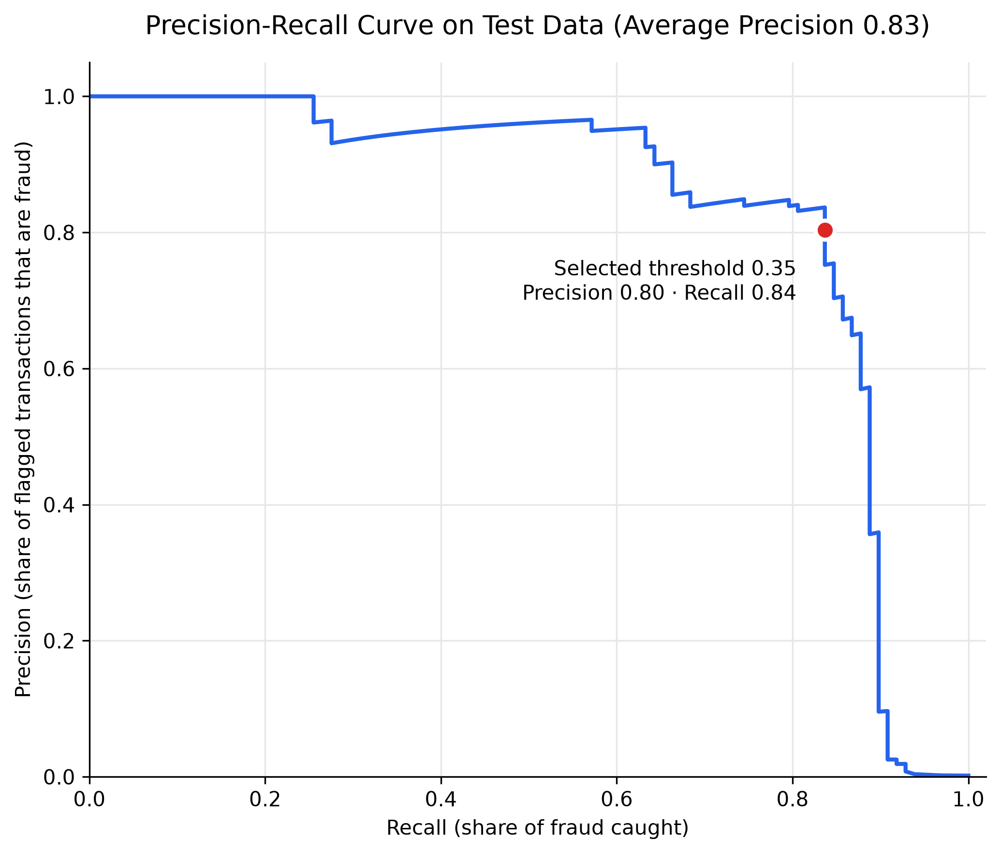
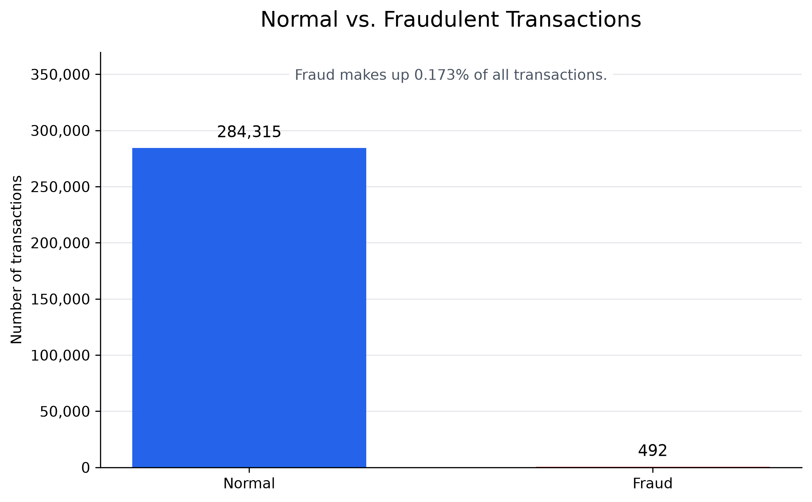
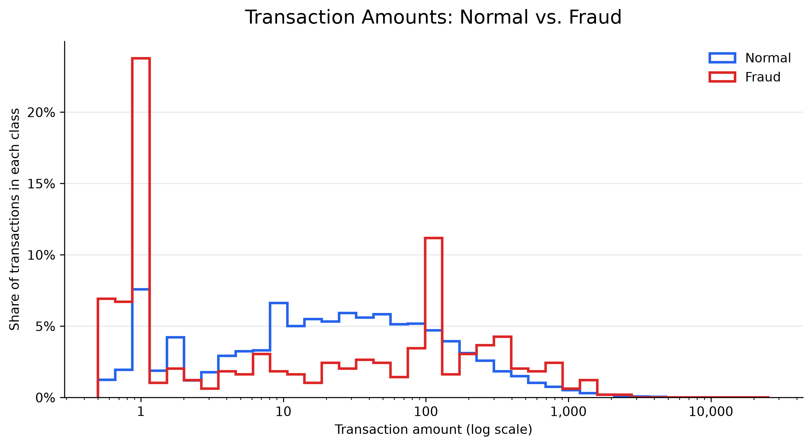
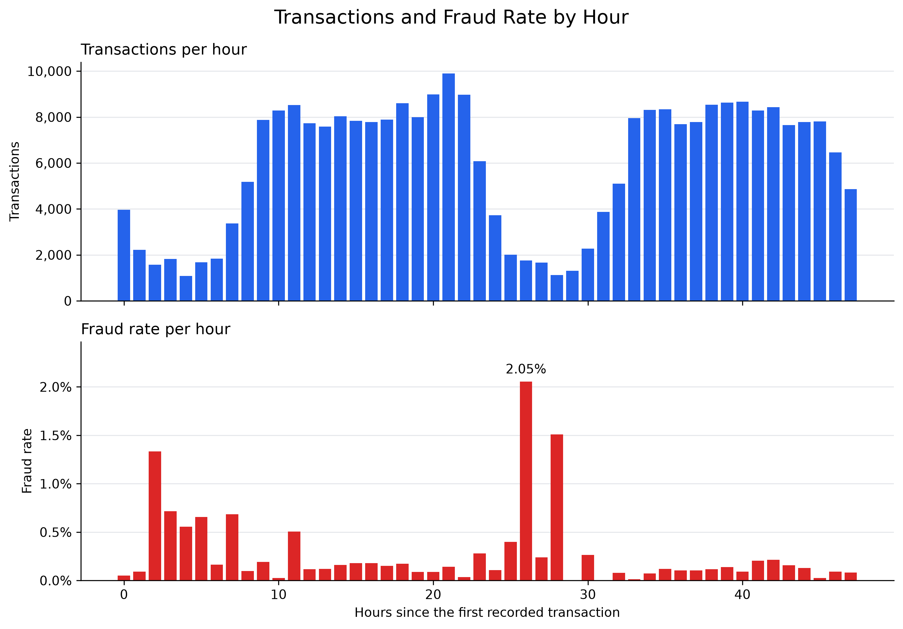
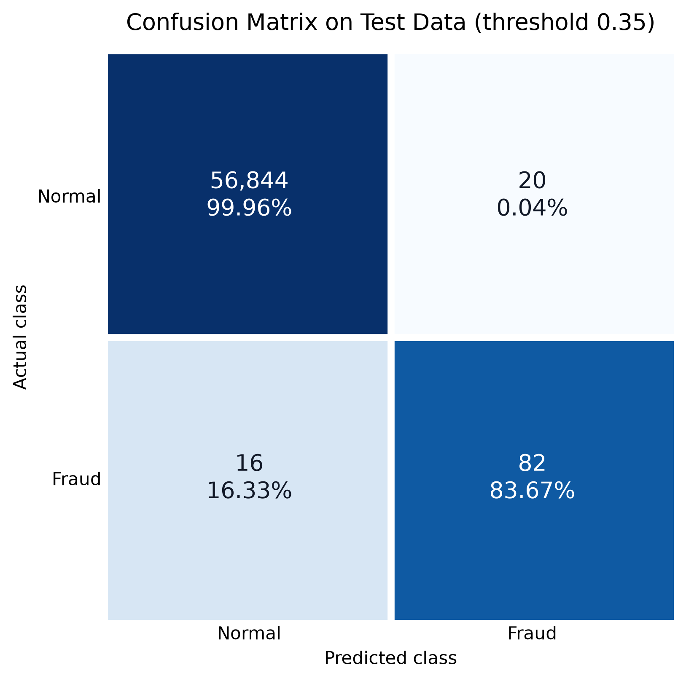
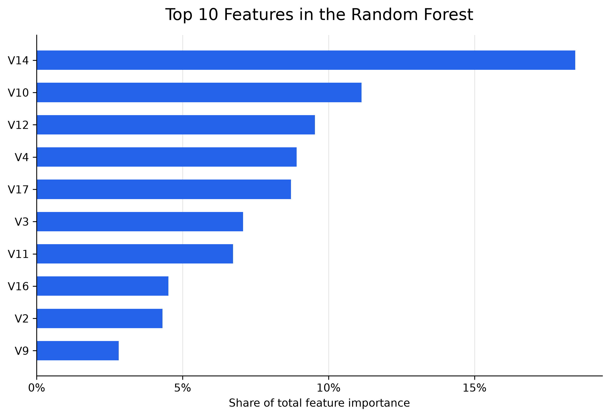

# Credit Card Fraud Detection & Analytics Dashboard

An end-to-end fraud detection project on **284,807 real card transactions**:
exploratory analysis, SQL fraud analytics, machine learning model comparison
with a tuned decision threshold, and an interactive **Streamlit dashboard**
that scores transaction files and returns a fraud risk score for every row.

## Results at a Glance

The final Random Forest was evaluated on a held-out test set of **56,962
transactions** that played no part in training or model selection.

| Metric | Test result |
|---|---:|
| Precision | **0.8039** |
| Recall | **0.8367** |
| F1-score | **0.8200** |
| Average Precision (PR-AUC) | **0.8288** |

The model caught **82 of the 98 fraud cases** in the test set while flagging
only **20 of 56,864 normal transactions** (0.04%).

| | Predicted normal | Predicted fraud |
|---|---:|---:|
| **Actual normal** | 56,844 | 20 |
| **Actual fraud** | 16 | 82 |



## Highlights

- **Rigorous evaluation:** stratified 60/20/20 train/validation/test split.
  Model choice and decision threshold were selected on validation data, and
  the test set was scored once at the end.
- **Built for imbalanced data:** fraud is only 0.173% of transactions, so the
  models use class weighting and are judged on precision, recall, F1 and
  Average Precision.
- **Threshold tuning:** thresholds from 0.01 to 0.99 were compared on
  validation data to find the best balance of precision and recall (0.35).
- **SQL analytics:** fraud rates by class and amount range, calculated with
  SQLite.
- **Interactive dashboard:** upload a CSV (or use the built-in sample) to get
  a risk score and predicted class for each transaction, with input
  validation and a downloadable results file.

## Dataset

[Credit Card Fraud Detection dataset (Kaggle)](https://www.kaggle.com/datasets/mlg-ulb/creditcardfraud):
284,807 transactions, of which 492 are fraud (0.173%). Features are `Time`,
`Amount` and 28 anonymised PCA components `V1`–`V28`. The target column
`Class` is `1` for fraud and `0` for normal.

## Exploratory Data Analysis





Fraud is concentrated in very small amounts: **36.8% of fraudulent
transactions are for 1.00 or less**, compared with 10.7% of normal
transactions.



Transaction volume follows a clear day/night cycle, and fraud stands out
overnight: the hourly fraud rate peaks at **2.05%, about 12 times the overall
rate**, and the three highest-rate hours all fall in the overnight
low-volume periods.

## SQL Analysis

`sql_analysis.py` loads the data into SQLite and runs the queries saved in
[`sql/fraud_queries.sql`](sql/fraud_queries.sql). Key findings
([full report](reports/sql_summary.txt)):

- Fraudulent transactions average **122.21**, about **38% higher** than
  normal transactions (88.29).
- Transactions of **500 and above** have the highest fraud rate, **more than
  twice** the rate of transactions under 100.

| Amount range | Transactions | Fraud | Fraud rate |
|---|---:|---:|---:|
| Under 50 | 189,704 | 305 | 0.161% |
| 50 to under 100 | 37,718 | 57 | 0.151% |
| 100 to under 500 | 47,893 | 95 | 0.198% |
| 500 and above | 9,492 | 35 | **0.369%** |

## Machine Learning

Two models were trained on the same split and compared on validation data,
each at its best F1 threshold:

| Model | Threshold | Precision | Recall | F1-score | Average Precision |
|---|---:|---:|---:|---:|---:|
| Logistic Regression | 0.99 | 0.5643 | 0.7980 | 0.6611 | 0.6807 |
| **Random Forest** | **0.35** | **0.8851** | 0.7778 | **0.8280** | **0.7758** |

**Random Forest was selected** for its higher F1-score and Average Precision.

- **Logistic Regression:** scikit-learn Pipeline with `StandardScaler` and
  `LogisticRegression(class_weight="balanced", max_iter=1000)`.
- **Random Forest:** 100 trees, `max_depth=12`,
  `class_weight="balanced_subsample"`, `random_state=42`.

The final model and its metadata (feature order and threshold) are saved in
`models/` and loaded by the dashboard.

### Model Evaluation





`V14` is the strongest fraud signal (18.5% of total feature importance),
followed by `V10` (11.1%) and `V12` (9.5%).

## Dashboard

```text
python -m streamlit run app.py
```

- **Overview:** dataset KPIs, EDA charts, the final test metrics and the
  model evaluation charts.
- **Fraud Prediction:** upload a transaction CSV to get a fraud risk score
  and predicted class for each row, plus a downloadable results CSV.
- **Built-in sample:** one switch scores 196 held-out test transactions
  (all 98 test fraud cases plus 98 normal transactions). The model flags
  82 of the 98 fraud cases and none of the normal transactions.

Uploaded files need the feature columns listed in
[`models/model_metadata.json`](models/model_metadata.json). Columns are
reordered automatically, an optional `Class` column is ignored, and missing,
non-numeric or infinite values are reported with clear messages.

## Run Locally

Requires **Python 3.12 or newer** (tested on Python 3.13).

```text
python -m pip install -r requirements.txt
python -m streamlit run app.py
```

The dashboard runs from the saved model and reports, so the dataset is only
needed to reproduce the analysis.

## Reproduce the Analysis

Download the dataset to `data/creditcard.csv`, then run the scripts in order:

| Step | Script | Output |
|---:|---|---|
| 1 | `explore_data.py` | Dataset shape, missing values and class counts |
| 2 | `fraud_analysis.py` | `charts/fraud_distribution.png` |
| 3 | `eda_charts.py` | `charts/amount_distribution.png`, `charts/time_distribution.png` |
| 4 | `sql_analysis.py` | `reports/sql_summary.txt`, `sql/fraud_queries.sql` |
| 5 | `train_model.py` | `reports/threshold_comparison.csv` (Logistic Regression threshold sweep) |
| 6 | `compare_models.py` | `reports/model_comparison.csv` |
| 7 | `finalize_model.py` | `models/`, `reports/final_test_results.txt` |
| 8 | `evaluation_charts.py` | `charts/precision_recall_curve.png`, `charts/confusion_matrix.png`, `charts/feature_importance.png` |
| 9 | `create_sample.py` | `samples/test_transactions.csv` (196 held-out test transactions) |

## Project Structure

```text
Credit_Card_Fraud_Project/
├── app.py                  # Streamlit dashboard
├── explore_data.py         # Initial data checks
├── fraud_analysis.py       # Class balance chart
├── eda_charts.py           # Amount and time charts
├── sql_analysis.py         # SQLite fraud analytics
├── train_model.py          # Logistic Regression baseline + threshold sweep
├── compare_models.py       # Logistic Regression vs. Random Forest
├── finalize_model.py       # Final model, test evaluation, saved artefacts
├── evaluation_charts.py    # Precision-recall, confusion matrix, feature importance
├── create_sample.py        # Dashboard sample from the held-out test set
├── requirements.txt
├── charts/
├── data/                   # creditcard.csv (download from Kaggle)
├── models/                 # fraud_model.joblib, model_metadata.json
├── reports/                # SQL summary, model comparison, test results
├── samples/                # test_transactions.csv
└── sql/                    # fraud_queries.sql
```

## Tech Stack

Python · pandas · NumPy · Matplotlib · SQLite · scikit-learn · joblib ·
Streamlit

## Next Steps

- Time-based validation: train on earlier transactions and test on later ones.
- Benchmark gradient boosting models (XGBoost, LightGBM).
- Choose the decision threshold by business cost, using transaction amounts.
- Add SHAP explanations for individual risk scores.
- Add automated tests for the upload validation.

## Author

**Ghazal Ashraf** · [GitHub](https://github.com/GhazalAshraf)
